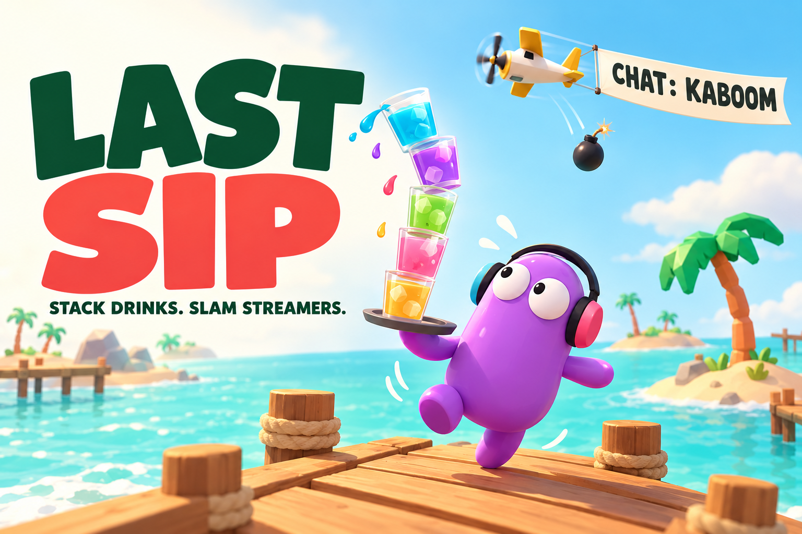
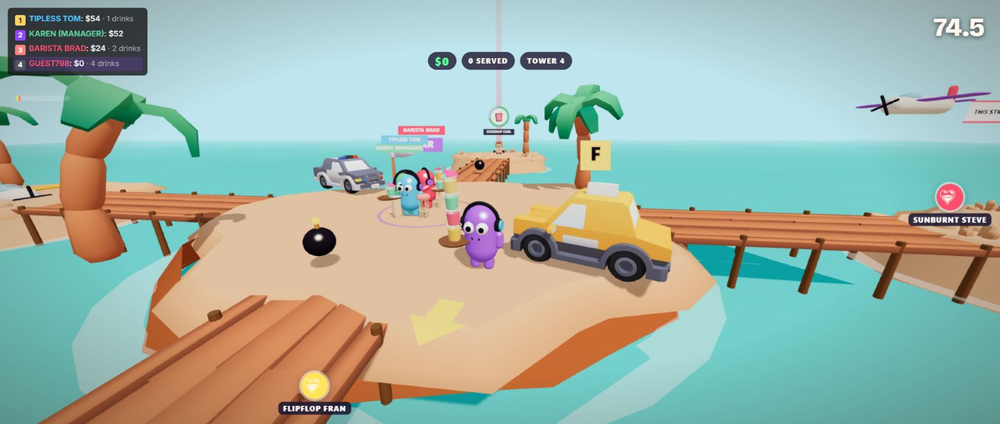

<div align="center">

# LAST SIP
### Stack drinks. Slam streamers.

**A 90-second beach-bar brawl where Twitch chat runs the sky.**

[Play in your browser](https://lastsip-seven.vercel.app) · [Gameplay trailer](video/trailer.mp4) · [Connect your chat](#bring-your-twitch-chat) · [Run locally](#run-locally)



*Promotional artwork. The game runs in your browser.*

</div>

You have one job: get the drinks to the customers. Stay at the bar and the tower keeps growing. A taller stack earns bigger tips, but every turn makes it wobble. Meanwhile, rivals can body-slam you, steal a taxi, or inflate you with a CO₂ gun until you float away and pop.

Then your chat types **kaboom**.

A plane crosses the arena, towing that viewer's message on a banner. It drops bombs on the leader. Your tower goes flying. There is a name attached to the disaster.

## Try it in a minute

1. Open **[lastsip-seven.vercel.app](https://lastsip-seven.vercel.app)** on a desktop browser.
2. Choose **SOLO** to play against three rival bots. Connecting Twitch is optional.
3. Walk into the ring at the central **BAR** to stack drinks. Leave when you dare.
4. Carry enough drinks to a waiting customer on an outer island to serve them automatically.
5. Earn the most tips before the 90 seconds run out. Attack your rivals if they get ahead.

**To play together:** choose **CREATE ARENA**, copy the invite link, and have another player join. Each player can connect their own Twitch channel. No game download or game account is required.



*Actual browser gameplay. The standings and chat framing stay clear of the action.*

## Bring your Twitch chat

Enter a public channel name and select **CONNECT CHAT**. LAST SIP reads that channel through Twitch's chat WebSocket; viewers participate from ordinary Twitch chat. This read-only connection does not require the streamer to register a developer app, copy a token, or install a bot.

| Viewer action | What happens in the arena |
|---|---|
| `!bomb get him` or `kaboom` | A plane carries the viewer's message and bombs the leader. In solo, it targets the player. |
| `!care` or `mayday` | A parachute care package delivers bomb pickups. |
| `!seagull` or `seagull` | A gull steals the top drink from the tower. |
| `!swap` or `swapsies` | Swap drink towers with a rival. |
| `!chairs` | Swap places with a rival. |
| `1`, `2`, or `3` during a ballot | Vote on the next event. |
| Send an ordinary message | Enter the customer raffle; chatters can name rival bots and appear on banner planes. |
| Cheers, subscription notices, gift subscriptions and raids | Recognised chat metadata triggers supporter events, including larger airstrikes. |

Free commands have cooldowns. In a busy chat, commands participate through ballots rather than firing every message immediately. Text-enabled channel-point rewards can also be recognised from their chat messages; this is not a listener for every possible reward redemption.

**Quick integration check:** the channel can be offline. Open its Twitch pop-out chat while signed in, connect LAST SIP to that same channel, start SOLO, and send `!bomb hello from chat`. Keep the game and chat visible together: the viewer's message should appear on the passing banner. In a busy chat, use the ballot and allow for cooldowns.

The bottom-left **LIVE** badge identifies the connected channel. The event feed quotes the chat line that caused an action; press **C** to expand the full chat. Local demo events and house planes are not proof of a live Twitch connection.

> The dollar amounts and tips inside LAST SIP are game points. The game does not collect cash donations or award money. Bits and subscriptions are Twitch actions; external donation services are not integrated.

## Why the tower matters

- **Greed creates the risk.** Stay at the bar for one more glass, or leave with a stack you can control.
- **The audience leaves fingerprints.** A message becomes a banner; a chatter becomes a customer; sabotage has an owner.
- **Rivals can fight back.** Slams, bombs, vehicles and tower swaps turn a delivery into a confrontation.
- **Short rounds invite a rematch.** The winner is decided in 90 seconds. A shared date seed selects the daily house rule: low gravity, stronger wind, faster cars and other variations.

The current public modes are repeatable party rounds. Daily best scores are saved in the browser; the older official-pour streak flow is not exposed through the current start buttons. This release is not presented as a verified global daily competition.

## Controls

| Input | Action |
|---|---|
| **W A S D** + mouse | Move and look; click the game to lock the pointer |
| **Space** / **Shift** | Hop / walk carefully |
| **E** | Body-slam |
| **Q** | Throw a bomb when carrying one |
| **R** | Fire the CO₂ gun when carrying ammunition |
| Left click, while pointer is locked | Fire CO₂ if available; otherwise throw a bomb |
| **F** | Enter or leave a nearby car or plane |
| **A D** / **W S**, in the plane | Bank / climb and dive; **Q** drops bombs |
| **M** / **C** | Map / expand chat |
| **Escape** | Release the pointer |

The front-page **SOUND ON / OFF** control remembers your preference. There is no microphone requirement and no looping music.

## Run locally

Use **Node.js 20.19+ or 22.12+**, npm, and a modern desktop browser with WebGL.

```sh
npm ci
npm run dev
```

Open the local URL printed by Vite, normally `http://127.0.0.1:5173`. Solo play and public chat reading do not require environment variables. Internet access is needed for Twitch, hosted multiplayer and external fonts/emotes.

```sh
npm run check       # entry-point syntax checks
npm test            # simulation, Twitch parsing and conductor tests
npm run build       # production bundle in dist/
npm run preview     # serve that bundle locally
```

Live arenas use Supabase Realtime. The client has a public anonymous configuration; see [.env.example](.env.example) and [SETUP.md](SETUP.md) for your own deployment. Optional authenticated Twitch and leaderboard infrastructure is separate from the anonymous chat path. Never place a Twitch client secret or a Supabase service-role key in a browser environment variable.

## Under the hood

| Part | Implementation |
|---|---|
| Rendering | Three.js, shared geometry/materials, batched island meshes, adaptive resolution and a single shadowed sun |
| Drink tower | Spring-driven lean, height-amplified instability, animated liquid levels and tumbling glasses |
| Round | Fixed 120 Hz simulation with interpolated rendering; customer orders, tips, rivals and ring-outs |
| Twitch | IRC over WebSocket; message/tag parsing, reconnects, ballots, raffles and command cooldowns |
| Multiplayer | Supabase Realtime broadcasts with interpolated peers and victim-applied hits; intended for casual play, not authoritative competitive scoring |
| Audio | Kenney samples, differentiated action cues, impact cooldowns, filtering and compression through Web Audio |
| Art | Procedural bean streamers and effects, plus Kenney CC0 environments, furniture and vehicles |

### Built with Codex

OpenAI Codex scaffolded the early prototypes and helped build the Twitch client/director, movement, simulation and core mechanics. Claude Code contributed review, the arena redesign, polish and the trailer capture pipeline. The project was iterated through playable prototypes rather than treating a generated concept video as the product.

The hackathon submission includes the principal Codex build session ID and demonstration footage separately. See [the submission story](DEVPOST_SUBMISSION.md) for the project narrative.

### Find your way around

- [`src/game/`](src/game/) — arena, characters, drinks, rivals, vehicles, effects and interface.
- [`src/twitch.js`](src/twitch.js) — Twitch chat connection, parsing and director.
- [`src/net.js`](src/net.js) — live-room transport.
- [`tests/`](tests/) — focused simulation and chat tests.
- [`GAME_DESIGN.md`](GAME_DESIGN.md) — design intent and mechanics.
- [`ASSET_CREDITS.md`](ASSET_CREDITS.md) — asset sources and licences.
- [`VIDEO_SCRIPT.md`](VIDEO_SCRIPT.md) — demonstration script and capture checklist.

`?dev` exposes local testing helpers; `?seed=YYYY-MM-DD` selects a day. `/legacy.html` and `/lab/` preserve early experiments. The main game is `/`.

---

**One more drink. One bad decision. Your chat has planes.**
